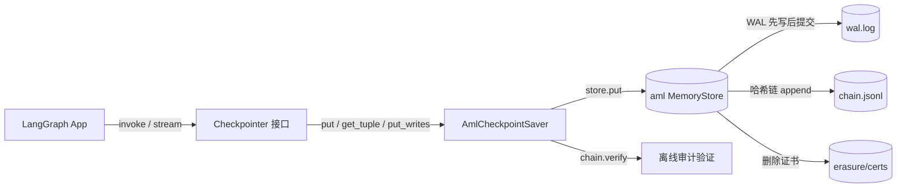
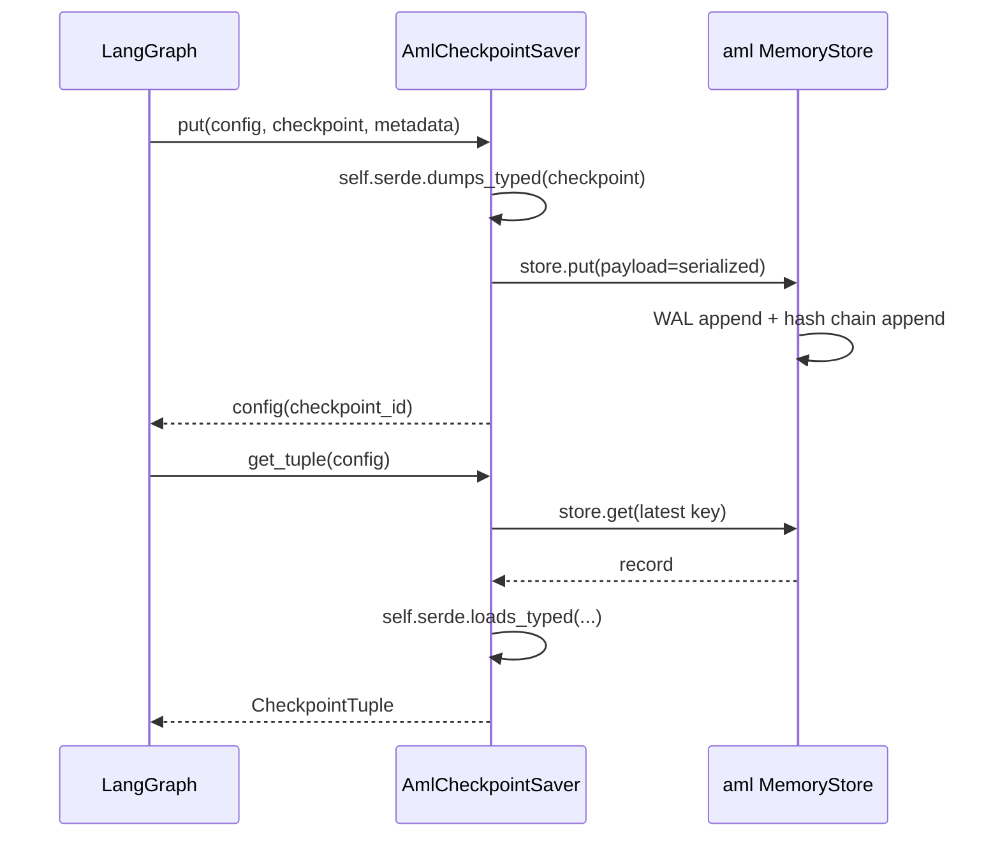
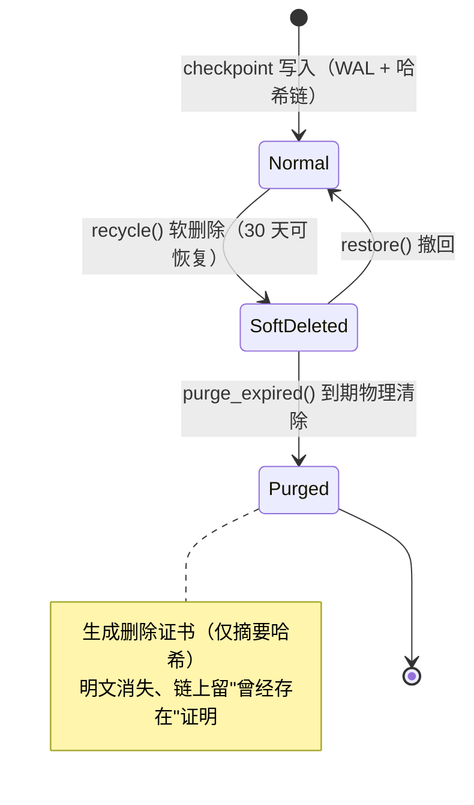

# 给 LangGraph 加一道可审计记忆：替换默认 Checkpointer，实现防篡改 + 崩溃不丢数据

> 面向：正在用 LangGraph 做生产级 Agent、又需要审计/留痕的团队。
> 你将从一篇可运行的 Demo 里看到：如何在不改 LangGraph 语义的前提下，把每个 checkpoint 变成可离线验证的审计记录。

@[toc]

---

## 一、为什么需要"可审计的 checkpoint"

LangGraph 的 Checkpointer 负责保存图的中间状态（channel、节点输出、pending writes），是断点续跑的基础。默认的 `MemorySaver` / `SqliteSaver` 解决的是"存得下、读得回"。

但**受监管场景（EU AI Act 高风险 Agent、GDPR 可证明删除、金融/保险工作流）需要的不只是"存"**：

- 状态是怎么一步步变成现在的？（可追溯）
- 有没有人/程序改过历史状态？（防篡改）
- 进程崩溃后，历史记录还在不在？（崩溃恢复）
- 删除某段记忆后，能不能出具"已删除"的凭证？（可证明删除）

这正好是开源库 [agent-audit-memory](https://gitcode.com/gcw_MKhSyoGN/agent-memory-ledger)（包名 agent-audit-memory，`import aml`）设计解决的问题：WAL 先写后提交、哈希链留痕、可证明删除、写入锁——一个"审计级"记忆底座。

**本教程的核心**：把 LangGraph 的 Checkpointer 换成 `aml` 来持久化——**checkpoint 作为 aml 的 payload 存入，aml 负责完整性与审计**，LangGraph 自己的语义（断点、恢复、快照）完全不受影响。

> ⚠️ 契约边界：aml 只接管"持久化 + 审计"，不改变 LangGraph checkpoint 的语义；LangGraph 内部 bug / 快照覆盖不在 aml 保障范围。

### 架构总览





第一条图：**数据流**——LangGraph 只看见 Checkpointer 接口，aml 在底层负责 WAL、哈希链、删除证书三套审计件。
第二条图：**时序**——写入先过 serializer 再进 aml；读取时反向还原，双方互不感知对方内部结构。

## 二、先看效果：真实运行输出

下面是 Demo（`examples/langgraph_checkpointer_demo.py`）在本机跑出的真实输出：

```text
== LangGraph <-> agent-audit-memory checkpointer demo ==
run1 -> {'count': 1}
run2 -> {'count': 2}
chain verify: (True, None, 10)     # 哈希链 10 条，全部可离线验证
stored checkpoints: 6              # LangGraph 每步状态都留了痕
WAL replay: 10 valid, 0 bad        # 崩溃重放无损
resume -> {'count': 100}           # 状态恢复正确，checkpointer 真正在工作
```

三个关键信号：
1. **`chain verify: (True, None, 10)`** —— aml 为每次 checkpoint 写入维护了一条哈希链，`verify()` 可离线重算全链；任何一行被篡改，立即返回 `False` 和坏行号。
2. **`WAL replay: 10 valid, 0 bad`** —— 所有写入先落写前日志（WAL），崩溃后可重放，不丢不重复。
3. **`resume -> {'count': 100}`** —— 从最新 checkpoint 恢复状态，证明它不是"只存不读"的摆设。

### 为什么这三行输出重要

| 输出 | 对应能力 | 受监管场景的意义 |
|:--|:--|:--|
| `chain verify: (True, None, 10)` | 哈希链离线验证 | 审计时可独立复现"状态未被篡改"，不需要信任任何单一节点 |
| `WAL replay: 10 valid, 0 bad` | 写前日志崩溃恢复 | 断电/崩溃后历史记录完整可重放，符合 EU AI Act Art.12 事件留痕思路 |
| `resume -> {'count': 100}` | checkpoint 真实恢复 | 断点续跑正常，说明审计增强没有破坏 LangGraph 原有行为 |
| `stored checkpoints: 6` | 每步状态留痕 | 决策过程可回溯，出问题能查到"从哪一步开始错" |

## 三、核心代码：最短可用的 AmlCheckpointSaver

完整代码在仓库 `examples/langgraph_checkpointer_demo.py`，核心只有几十行：

```python
from langgraph.checkpoint.base import BaseCheckpointSaver, CheckpointTuple
from aml import MemoryStore


class AmlCheckpointSaver(BaseCheckpointSaver):
    """把 LangGraph checkpoint 存进 aml（审计级）。"""

    def __init__(self, store: MemoryStore):
        super().__init__()
        self.store = store
        self._seq = 0

    def _serialize(self, obj):
        """LangGraph 内部对象（如 Runtime）用自带 serde 转成可 JSON 的字节。"""
        import base64
        typ, blob = self.serde.dumps_typed(obj)
        return {"t": typ, "b": base64.b64encode(blob).decode("ascii")}

    def _deserialize(self, holder):
        import base64
        return self.serde.loads_typed((holder["t"], base64.b64decode(holder["b"])))

    def put(self, config, checkpoint, metadata, new_versions):
        thread_id = (config.get("configurable") or {}).get("thread_id", "default")
        key = f"{thread_id}::{self._seq}"
        self.store.put({
            "layer": "core", "key": key,
            "payload": {
                "checkpoint": self._serialize(checkpoint),
                "metadata": self._serialize(metadata),
            },
            "meta": {"source": "langgraph-checkpointer", "thread_id": thread_id},
            "sanitize": False,
        })
        self._seq += 1
        return {"configurable": {**config.get("configurable", {}), "checkpoint_id": key}}
```

这段代码的关键决策，逐个解释：

1. **为什么 `put` 返回新 config？** Checkpointer 接口约定：写入后返回带 `checkpoint_id` 的 config，LangGraph 后续用它在多线程/多分支场景定位"下一个 checkpoint 的父节点"。我们简单用 `thread_id + 序号` 作为 key，既保证可排序，也让审计日志里能看到"这是第几条状态"。
2. **为什么 `sanitize=False`？** aml 默认会对 payload 做脱敏（把疑似密码/密钥替换为 `[REDACTED]`）。但 checkpoint 已经过 LangGraph serde 序列化，是**不透明字节**，脱敏规则可能误伤序列化字节；且状态本身经 `sanitize` 后无法反序列化回原对象。因此显式关掉默认脱敏——**调用方负责确认 payload 不含明文敏感信息**（这是一个刻意的决策，不是疏忽）。
3. **为什么继承 `BaseCheckpointSaver` 而不是实现接口？** 基类自带 `serde` 实例（`JsonPlusSerializer`）和异步方法骨架，我们只需要覆盖同步核心方法；异步方法委托给同步实现即可在 demo 里跑通 AsyncGraph。

`get_tuple`（读最新）和 `put_writes`（存 pending writes）的完整实现见仓库；`get_tuple` 按 `thread_id::` 前缀倒序取最新一条，`put_writes` 把每个 task 的写入序列化后存进 `archive` 层（审计层与业务状态分层存放，便于单独归档）。

接入 LangGraph 只需要一行：

```python
store = MemoryStore("./mem", namespace="langgraph-demo")
app = g.compile(checkpointer=AmlCheckpointSaver(store))   # 替换原来的 saver
```

之后每次 `app.invoke(..., config={"configurable": {"thread_id": "thread-1"}})`，都会在 aml 里留下一条哈希链记录。

### 如果你用的是 AsyncGraph

LangGraph 的 AsyncGraph 会调用 `aput` / `aget_tuple`。基类没把异步方法设为抽象，但我们 demo 里显式实现了委托：

```python
async def aput(self, config, checkpoint, metadata, new_versions):
    return self.put(config, checkpoint, metadata, new_versions)

async def aget_tuple(self, config):
    return self.get_tuple(config)
```

这样 `AsyncStateGraph` 也能直接用同一个 saver——同步异步共用一套审计逻辑，不重复实现。

## 四、实战踩过的 3 个坑（每一坑都值得记住）

### 坑 1：LangGraph checkpoint 不是 JSON 可序列化的
直接 `store.put(payload=checkpoint)` 会报：
```text
TypeError: Object of type Runtime is not JSON serializable
```
**为什么**：LangGraph 的 checkpoint 包含 Pregel 运行时对象（`Runtime`、channel 版本、task 状态等），不是纯 Python 原生类型。`json.dumps` 无法处理，报错直接暴露了这个内部类型。
**解法**：不要自己硬存，用 LangGraph 自带的 `self.serde.dumps_typed()`（JsonPlus）把对象序列化，再 base64 后存进 aml。为什么 base64？因为 serde 返回 `(type_str, bytes)`，而 aml 的 payload 是 JSON——bytes 必须转成 ASCII 字符串才能安全进 JSON，base64 是标准做法。
**教训**：写 Checkpointer 适配层时，**第一件事是确认对象的可序列化边界**，不要假设"能打印就能存"。

### 坑 2：新版接口不止 `put/get_tuple`，还有 `put_writes`
跑通 `put` 后立刻会遇到：
```text
NotImplementedError: put_writes
```
**为什么**：LangGraph 节点执行后会把任务结果（pending writes）也交给 saver 持久化；如果不实现，图的执行循环在写入阶段直接抛异常，一个 step 都跑不完。这个接口在旧版文档里不太显眼，极易漏掉。
**解法**：必须一起实现 `put_writes(config, writes, task_id, task_path)`。我们把它存进 `archive` 层——与核心 checkpoint 分层，这样审计时可以区分"图的权威状态"与"中间产物"。
**教训**：给 LangGraph 写 saver 时，用"最小完整接口集"检验：`put / get_tuple / put_writes / list` 四个都要有，别只实现前两个就发布。

### 坑 3：Windows 下临时目录清理会因排他锁失败
aml 默认对每个存储目录加**单写者排他锁**（fail-closed，第二个写进程会被拒）。Demo 早期在主流程末尾才 `store.close()`，一旦中途报错，锁没释放，临时目录删除时报 `PermissionError`：
```text
PermissionError: [WinError 32] 另一个程序正在使用此文件，进程无法访问。...aml.lock
```
**为什么**：`MemoryStore` 构造时持有排他锁（防止多进程互相踩坏状态）；`TemporaryDirectory.cleanup()` 删除目录时，只要锁文件句柄还开着就会失败。
**解法**：用 `try/finally` 保证 `store.close()`（释放排他锁）一定执行。这也是 aml 单写者设计的正确用法——**一个进程一个存储目录**；需要多进程时给每个进程独立 `namespace=`，或走未来的 SQLite 后端。
**教训**：排他锁是特性不是 bug——它能防多进程数据撕裂，代价是你必须显式释放。`try/finally` 或上下文管理器是标配。

### 附：调试 Checkpointer 的通用套路

```python
# 在 put 里临时打印，确认每次写入都发生
print("ckpt write:", thread_id, self._seq, "payload bytes:", len(str(payload)))
# 在异常时快速验证链完整性
print("chain verify:", self.store.chain.verify())
```

## 五、这能带来什么（受监管场景视角）

| 能力 | aml 提供的保障 | 落地要点 |
|:--|:--|:--|
| 状态可追溯 | 每次 checkpoint 写入都进 WAL + 哈希链，可按顺序重放 | 配合 `docs/AUDIT_LOG_FORMAT.md` 的字段规范，可被第三方审计工具解析 |
| 防篡改 | `chain.verify()` 离线重算全链，篡改立即暴露坏行号 | 审计方独立复现，不需要信任部署方自报 |
| 崩溃恢复 | WAL 先写后提交，崩溃后重放有效记录，不丢不重复 | `durability="strict"` 档每次 fsync，断电场景也安全 |
| 删除留证 | 软删除 30 天可撤回；到期 purge 生成**删除证书**（仅摘要，明文清除） | GDPR Art.17"可证明删除"的技术底座 |
| 单写者保护 | 每目录独占跨进程锁（fail-closed） | 防止多进程同时写同一个存储目录导致文件撕裂 |
| 命名空间隔离 | `namespace=` 物理分目录 | per-thread / per-tenant 数据分隔，避免 key 冲突 |

更完整的合规能力边界见仓库 `docs/compliance.md`（EU AI Act Art.12/13、GDPR Art.17 对照）与 `RETAIN_ERASE_POLICY.md`（删除状态流转：正常 → 软删除 → purge 出证）。

> ⚠️ 边界声明：这些能力是**技术底座**；"完整合规"还需要客户侧配套留存策略、访问控制、操作流程与组织制度——本库不替代合规认证，也不提供法律意义上的取证凭证。

## 六、性能与取舍（诚实版）

| 方案 | 写入开销 | 适合场景 | 备注 |
|:--|:--|:--|:--|
| `MemorySaver` | 极低（纯内存） | 开发调试、单次运行 | 不持久化，重启即失 |
| `SqliteSaver` | 低 | 常规持久化 | 无篡改检测 |
| aml (`normal`) | 中（JSON + 哈希 + 文件 IO） | 需要审计留痕的生产场景 | 本教程验证：`chain verify` + `WAL replay` 全过 |
| aml (`strict`) | 最高（每次 fsync） | 合规审计、断电零丢失 | 性能基线见仓库 `docs/performance.md` |

aml 当前是 JSON 文件后端（零运行时依赖），实测单条写入约 23–26ms（本机 SSD，见 `docs/performance.md`）——**适合低频但高价值的状态写入**（审计场景天然如此），不适合每秒几十次的高吞吐对话 Agent（那条路等 SQLite 后端）。这是刻意的取舍：把可靠性/可信放在第一位，吞吐让位。

### 删除状态流转（GDPR Art.17 的"可证明删除"是怎么实现的）



这张图回答监管最常见的两个问题：
1. **"你们怎么删数据？"** —— 两级删除：30 天内可撤回的软删除 + 到期后的物理清除（purge）。
2. **"删了怎么证明？"** —— purge 时生成删除证书（只含摘要、不含明文），哈希链上留下 `purge` 标记：证明"该条确曾存在、确已删除、明文不可恢复"，这正是 GDPR Art.17 被遗忘权的技术底座。

## 七、常见问题（FAQ）

**Q1：aml 会改变我现有 LangGraph 代码吗？**
不会。你只需要把 `compile(checkpointer=...)` 里的 saver 换成 `AmlCheckpointSaver(store)`，`invoke/stream` 的调用方式、thread_id 用法、断点语义完全不变。Demo 验证了 `resume -> {'count': 100}`——状态恢复与默认 saver 行为一致。

**Q2：我要存储的 Agent 状态里有敏感数据怎么办？**
aml 默认对 payload 做脱敏（`[REDACTED]`），但 checkpoint 经过 serde 序列化后是不透明字节，我们显式用了 `sanitize=False`——**这意味着调用方要对自己的状态内容负责**。生产建议：敏感字段在进图之前就脱敏/哈希，或把敏感状态放在 aml 之外，aml 只存"审计所需"的元数据与状态引用。

**Q3：多进程部署怎么办？**
aml 默认单写者（fail-closed，第二个进程会被 `ProcessContentionError` 拒绝）。多进程方案：每个进程独立 `namespace=`（物理分目录），或等 v0.3 SQLite 后端。这不是缺陷——正是它防止多进程同时写一个目录导致文件撕裂的设计。

**Q4：能拿它直接过 GDPR / EU AI Act 评审吗？**
不能，它只是**技术底座**。`docs/compliance.md` 明确区分了能力边界：本库提供事件留痕、可证明删除、防篡改的技术实现；完整合规还需留存策略、访问控制、操作流程、组织制度。但**评审时你可以指出"审计链路可独立核验、删除可出证"**——这正是开源可审计底座在合规评审中的价值。

**Q5：为什么不直接用 SQLite？**
`SqliteSaver` 适合常规持久化，但默认没有哈希链校验、没有删除证书、没有写入锁。aml 的定位是"在你要审计的东西外面加一层可信保证"，两者可以并存：未来 SQLite 后端会把 aml 的哈希链语义下沉到行级，而不是替代。

## 八、下一步 / Roadmap

- **v0.3**：内容级读取访问控制、来源溯源（哪条 prompt/工具调用产生了这条记忆）、可配置留存策略、独立审计事件流导出
- **规模化**：SQLite 后端（WAL 模式、事务化、可索引），用于多进程写和 >10k 条记录；哈希链语义下沉到行级（避免两层 WAL）
- **生态**：把本 Demo 沉淀成独立示例仓库 + 合规导出脚本（主仓库保持干净）；企业增强版（RBAC、审计事件推送、监控台）以附加组件形式提供

## 八、总结

用一个可运行的 Demo，把 LangGraph 的生产级 Checkpointer 换成了审计级存储器：

1. **不改 LangGraph 语义**：还是 `compile(checkpointer=...)`，还是 `invoke(config=thread_id)`；状态照常断点恢复（`resume -> {'count': 100}`）。
2. **每步状态都可审计**：`chain verify` 通过 + `WAL replay` 无损 + 写入留痕，出问题能查到"从哪一步开始错"。
3. **三个实战坑**：Runtime 序列化（用 LangGraph 自带 serde + base64）、`put_writes` 必实现、排他锁必须显式释放——都是运行一次就会撞上的真实问题。
4. **可信 ≠ 完整合规**：你拿到的是技术底座；完整合规还需组织流程配套（边界见 `docs/compliance.md`）。

适合谁：正在把 LangGraph 推向金融、政务、出海信贷等**需要自证合规**场景的团队。代码免费开源，欢迎 fork、试用、提 issue。

## 资源

- 仓库：`https://gitcode.com/gcw_MKhSyoGN/agent-memory-ledger`（MIT，零运行时依赖，Python 3.9+）
- PyPI：`pip install agent-audit-memory`（预发布版本；研究原型，生产使用前请自行审阅代码）
- 文档：`docs/compliance.md` / `RETAIN_ERASE_POLICY.md` / `docs/AUDIT_LOG_FORMAT.md`
- Demo：`examples/langgraph_checkpointer_demo.py`

> 免责声明：本库是技术底座，不是合规认证、不是法律取证凭证；完整合规落地还需配套留存策略、访问控制与组织流程，最终监管责任由部署方承担。AI 辅助开发，代码与文档经人工审阅与 80 项单元测试验证。